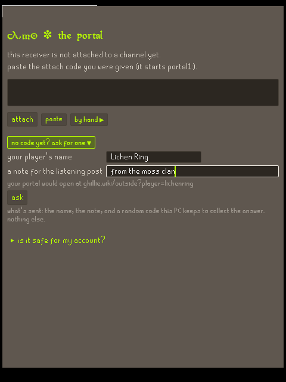
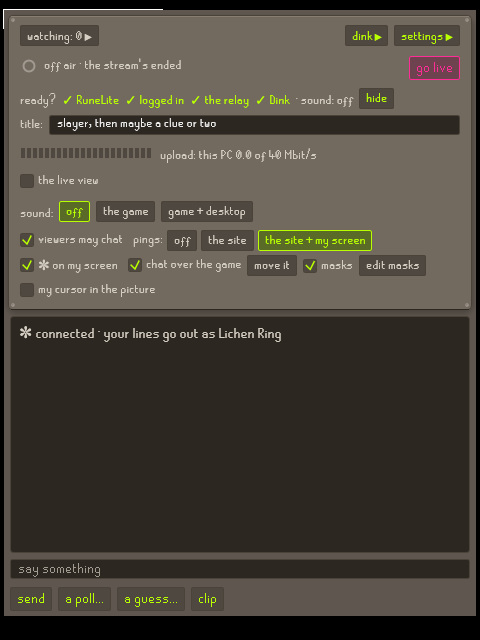
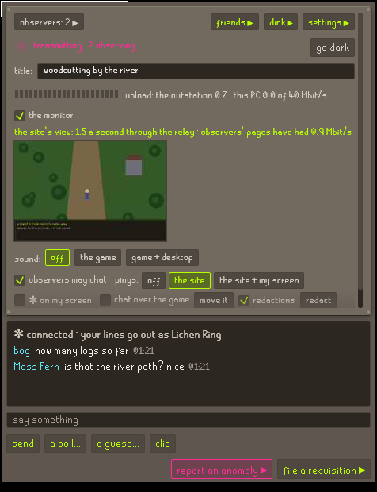

# outside-portal

A live portal from your RuneLite to your Outside page on [ghillie.wiki](https://ghillie.wiki) (`ghillie.wiki/outside?player=<you>`): a few frames a second of your game, its sound if you want, and a chat with whoever's watching.

**Being built.** The relay and the portal both work, tested on one PC. Nothing is released yet.

**Is it safe for my account?** It does what streaming software does and nothing more: it never touches RuneLite or the game, and it can't press a key or click for you. `SAFETY.md` says it in plain words, and says how to check every line yourself.

<p>
  
  
  
</p>

The first screen, ready to go live, and live with two viewers chatting. (Pictured under Wine, with a stand-in window in RuneLite's place.)

## In plain words

- **The portal** runs on your PC beside RuneLite. It reads RuneLite's window the way streaming software does, and sends it to the relay. It never touches the game: nothing a viewer does becomes input to it.
- **The relay** passes your stream on to everyone watching, so your home connection sends one copy however many watch. It runs on Cloudflare.
- **Your channel** is named after your player. Its key is yours alone.
- **What goes out:** RuneLite's game area, and nothing else on your screen. It stops while you're paused (the Pause key) or minimised, and the half second before either is taken back. If you use Dink, your level-ups, drops and the like go out too, but nothing that names another player.

## Setting it up

1. **Download** `outside-portal.exe` from the latest release (Releases, on the right of this page). It's one file, with nothing to install. Put it anywhere, your Desktop or Documents.
2. **Open it.** The first time, Windows may say "Windows protected your PC", because the portal isn't signed yet: press **More info**, then **Run anyway**. To check it's the real file first, see [SAFETY.md](SAFETY.md), "Checking it yourself". It asks once whether to put itself in your Start menu.
3. **Attach it to your channel.**
   - Got an attach code from Jace (it starts `portal1:`)? Paste it and press **attach**. If it's on your clipboard when the portal opens, it's pasted for you.
   - No code yet? Press **no code yet? ask for one**, type your player's name and a note so Jace knows who you are, and press **ask**. Leave the portal open (or open it again later): when he says yes, it attaches by itself.
   - Once it's attached, the **first-time setup** walks you through the rest a step at a time: Dink and Discord, pointing Dink at the portal, clips, the Start menu. Each step can be skipped, and settings ▸ more runs it again.
4. **Check it's ready.** Above the title, the ready check ticks what the portal needs: RuneLite open, logged in, the relay answering, and Dink heard (only if you use Dink). Hover over any of them to see how to fix it.
5. **Go live.** Your portal is at `ghillie.wiki/outside?player=<your name>`. **end stream** stops it.
6. **Your drops and level-ups under it** (if you use [Dink](https://github.com/pajlads/DinkPlugin)): **dink ▸** goes in three steps (the first-time setup does the same). 1: does Dink post to a Discord of yours? If so, the portal keeps that going as it is (`::dinkexport all` in RuneLite's chat, **read my Dink settings**, `::dinkimport`). 2: the portal's address goes in Dink's Primary Webhook URLs, and **no Discord address left there**, or Discord gets every post twice. 3: what shows under your portal (**default** is everything).

## While you stream

- **Press Pause before typing a bank PIN.** Viewers see static, and the half second before the press is taken back. Every key can be changed in the settings.
- **Minimised, nothing goes out.**
- **Masks:** **edit masks** lets you black out any part of the game (the chat, the world number) on your own PC, before a frame leaves it.
- **The sound:** off, the game, or game + desktop. Never a microphone.
- **The chat:** right-click a line to take it back, or to block or ban whoever wrote it. "viewers may chat" switches the chat off.
- **Clips:** the clip key (Insert) saves the last seconds as a video in `Videos\outside-portal` (give the replay buffer some seconds in the settings first). With Dink, a pet, a new collection log slot, a 99 or a drop worth a million or more saves one by itself, named for it (**dink ▸**, "clips by themselves"). Switch on "and put them on my Outside page" there, and those go under "recovered footage" on your page too: a still each, moving under the hand, playing when pressed. The newest 20 stay for 30 days; **keep** holds up to 3 for good, and the same drawer takes any down.
- **Going live by itself:** settings ▸ more ▸ **go live by itself whenever RuneLite opens**, and with it **end the stream when RuneLite closes** (after 30 s, so an update's restart doesn't end it). If you press end stream while RuneLite's open, the portal stays off air until RuneLite next opens.
- **Dink and your Discord, as Jace has them:** dink ▸ ▸ "on to your Discord too". Type `::dinkexport all` in RuneLite's chat, press **read my Dink settings**, type `::dinkimport`, then delete your Discord address from Dink's webhook list (the portal names the boxes). The portal then hears everything Dink can tell it, and your Discord keeps getting just what it got before, passed on by the portal while it's open. **undo** puts your old Dink settings back on the clipboard.
- **Your friends list** (**friends ▸**), as the game's own: **add friend**, type their name, and see whether their portal is live (lime), off air (pink) or not there (grey, or friends-only). Click a name for their Outside page; right-click to delete. Hover over a live one for a small live view of their portal. The chat says "Moss Fern has gone live." when one does, and so does a Windows notification if the portal's in your Start menu.

## If something goes wrong

- **"RuneLite" isn't ticked:** RuneLite has to be open and not minimised, and its window's title has to start with "RuneLite" (settings ▸ more).
- **"logged in" isn't ticked:** log in, or turn on RuneLite's "username in title". It's only needed for "nothing while logged out" (settings ▸ more).
- **The picture is black:** in settings ▸ more, try another "taken by".
- **Dink isn't heard:** the address from **dink ▸** has to be on a line of its own in Dink's Primary Webhook URLs, in the RuneLite profile you're playing on.
- **"too old for the relay":** download the newest release and open that one.
- **It crashed:** it says so, and says so again the next time it opens. In the settings, under **more**, press **copy my log**, then paste it into a new issue here ("Something went wrong") or send it to Jace. Your key, codes and webhook addresses are taken out first.

## Which Windows

Windows 10 or 11, 64-bit. It uses Windows Graphics Capture, as OBS does, and falls back to an older way on a PC without it. Windows only, for now.

## Uninstalling

Close it (from the ✼ by the clock, if it's in the tray), then delete:
- `outside-portal.exe`, wherever you put it
- `%APPDATA%\outside-portal`: its settings, its log and its icon
- `Videos\outside-portal`, if you saved clips
- the Start menu's shortcut, if you added one (settings ▸ more takes it out)

Your channel stays yours until Jace takes it back: ask him if you want it gone.

## For developers

### The parts

- `client/`: the broadcaster, `outside-portal.exe` (Rust): the capture, the sound, the chat window with its drawers, Dink, the tray. `client/PARITY.md` lists everything ghillie's Python portal did and what the client does for each.
  - Building it on Windows: Rust, with cmake and ninja on the PATH for libopus. GitHub's machines build the releases with MSVC; Jace's PC uses the gnullvm toolchain (`rust-toolchain.toml`). Then `cargo build --release`.
  - `outside-portal.exe --once frame.png` writes one frame; `--bench 30` times a frame stage by stage.
  - The keeper's own build, the field station: `cargo build --release --features station` (ghillie's `tools/launcher/build_station.py`). The same portal, with the keeper's tools in its tray (what ghillie's `launcher.json` starts, modes, links) and friends' portals handed out from a drawer (`client/src/station.rs`, `keeper.rs`). A release is never built with it.

- `relay/`: the relay on Cloudflare: a Worker, with a Durable Object for each channel (TypeScript). Its README says how to run it and deploy it.
- `relay-py/`: the same relay in Python, standard library only, for running on your own PC (`py relay-py/relay.py`). It's also the reference.
- `docs/protocol.md`: what the client, the relay and the page say to each other.
- `tests/protocol_test.py`: the same tests run against either relay.
- `tests/fanout_bench.py`, `tests/fanout_local.py`: how one channel holds up with many viewers and some stalled ones.
- `tests/client_live.py`: the client end to end against either relay, with RuneLite open. `tests/client_screens.py` takes pictures of its screens.
- `tests/safety_check.py`: what the built program can call in Windows, read from the file itself (SAFETY.md).

### Tests

```bash
py tests/protocol_test.py
```

That runs against the Python relay. To run against the Worker under `wrangler dev` (after `npm install` in `relay/`):

```bash
PORTAL_RELAY=worker py tests/protocol_test.py
```

```bash
py relay-py/test_relay.py
```

## Licence

MIT (`LICENSE`). The two RuneScape fonts in `client/assets/fonts` are WolfieMario's, under their own Creative Commons BY-NC-SA licence (`client/assets/fonts/README.md`).
