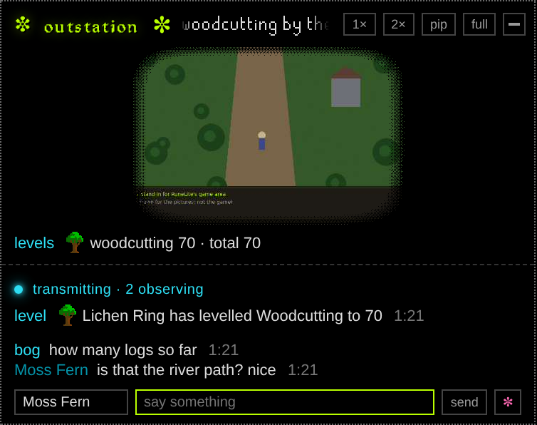
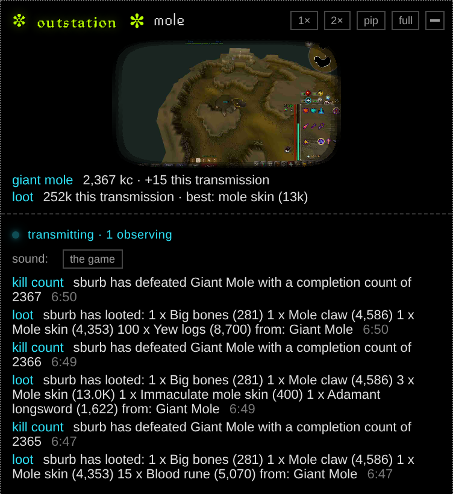

# ⊂λ,ｍ⊙ outstation

An outstation on your PC, transmitting your RuneLite to your Outside page on [ghillie.wiki](https://ghillie.wiki) (`ghillie.wiki/outside?player=<you>`): a few frames a second of your game, its sound if you want, and a chat with whoever's observing.

**Being built.** The relay and the outstation both work, tested on one PC. Nothing is released yet.

> **The only official download is this repository's [Releases](https://github.com/jhmcubed/outstation/releases) page** (github.com/jhmcubed/outstation). ⊂λ,ｍ⊙ never sends the outstation any other way: a copy passed round in Discord, a DM, a forum or another website isn't ours, whatever it's called and however it looks. Never run an .exe you don't trust. RuneScape players are a favourite target of programs that pretend to be game tools and steal accounts, so before you run any copy, check its SHA-256 against the release's ([SAFETY.md](SAFETY.md), "Checking it yourself"). If someone offers you an outstation from anywhere else, don't open it, and tell the listening post (research@ghillie.wiki).

**Not Jagex's, and not RuneLite's.** Created using intellectual property belonging to Jagex Limited under the terms of Jagex's Fan Content Policy. This content is not endorsed by or affiliated with Jagex. It isn't a RuneLite plugin either, and isn't made by or affiliated with RuneLite.

**Is it safe for my account?** It does what streaming software does and nothing more: it never touches RuneLite or the game, and it can't press a key or click for you. [SAFETY.md](SAFETY.md) says it in plain words: what's in the picture, everything that leaves your PC and where it goes, everything that comes back and what none of it can do, what the relay keeps, and how to check every line yourself.

<p>
  
  
  
</p>
<p>
  
</p>

The first screen; attached and dark, ready to transmit; transmitting to two observers; and what they see on the player's Outside page. (Pictured under Wine, with a screenshot of sburb's RuneLite standing in for the game.)

<p>
  
</p>

A real transmission, as observers see it on Outside (sburb at the Giant Mole, 11/07/2026): the picture; the boss with its kill count and how many this transmission; how dry its pet is, from the player's own collection log (RuneProfile and Wise Old Man); this transmission's loot and the best drop; and each kill count and loot as Dink tells of it, with the boss's and the items' pictures.

**Its words.** The window speaks ⊂λ,ｍ⊙'s language. Your **station key** is the code that attaches it to your channel; **transmitting** is live and **dark** is off air; **observers** are your viewers, and **on standby** the ones waiting for a seat; **the tape** is the replay buffer (the last seconds, always rolling); **redactions** are masks; **the monitor** is the small live view of what went out; **field reports** are Dink's posts; **the station check** is the ready check. The keeper **issues** keys, **denies** a request, **re-keys** a channel (a new key; the old one stops working) and **stands one down** (takes it back).

## In plain words

- **The outstation** runs on your PC beside RuneLite. It reads RuneLite's window the way streaming software does, and sends it to the relay. It never touches the game: nothing a viewer does becomes input to it.
- **The relay** passes your transmission on to everyone observing, so your home connection sends one copy however many watch. It runs on Cloudflare.
- **Your channel** is named after your player. Its key is yours alone.
- **What goes out:** RuneLite's game area (nearly always: if the outstation can't find it, the whole window, side panel too; and, in one rare fallback, the windows over it), your sound only if you turn it on, and the chat. No picture goes out while you're paused (the Pause key) or minimised, and the half second before either is taken back. If you use Dink, your level-ups, drops and the like go out too: only each one's line and a few numbers, never the screenshot, and nothing that names another player.
- **What comes back:** viewers' chat lines, pings, ✼ and votes, shown as text and drawn in the outstation's own windows. Nothing a viewer sends can press a key, click, open a page or reach RuneLite.
- **Whatever's drawn in the game area is in the picture:** your login screen (an older account's username is typed there in plain sight), the game's chat with other players' names, RuneLite's overlays. Log in before going live, and mask what you'd rather not show (SAFETY.md, "What's in the picture").

## Setting it up

1. **Download** `outstation.exe` from the latest release (Releases, on the right of this page). It's one file, with nothing to install. Put it anywhere, your Desktop or Documents.
2. **Open it.** The first time, Windows may say "Windows protected your PC", because the outstation isn't signed yet: press **More info**, then **Run anyway**. To check it's the real file first, see [SAFETY.md](SAFETY.md), "Checking it yourself". It asks once whether to put itself in your Start menu.
3. **Attach it to your channel.**
   - Got a station key from Jace (it starts `outstation1:`, or `portal1:` from before the name changed)? Paste it and press **attach**. If it's on your clipboard when the outstation opens, it's pasted for you.
   - No key yet? Press **no key yet? request one**, type your player's name and a note so Jace knows who you are, and press **request**. Leave the outstation open (or open it again later): once he issues your key, it attaches by itself.
   - Once it's attached, the **first-time setup** walks you through the rest a step at a time: Dink and Discord, pointing Dink at the outstation, clips, the Start menu. Each step can be skipped, and settings ▸ more runs it again.
4. **Check it's ready.** Above the title, the station check ticks what the outstation needs: RuneLite open, logged in, the relay answering, and Dink heard (only if you use Dink). Hover over any of them to see how to fix it.
5. **Your drops and level-ups under it** (if you use [Dink](https://github.com/pajlads/DinkPlugin)): **dink ▸** goes in three steps (the first-time setup does the same). 1: does Dink post to a Discord of yours? If so, the outstation keeps that going as it is (`::dinkexport all` in RuneLite's chat, **read my Dink settings**, `::dinkimport`). 2: the outstation's address goes in Dink's Primary Webhook URLs, and **no Discord address left there**, or Discord gets every post twice. 3: which field reports go out (**default** is everything).
6. **Log in, then transmit.** Your outstation is at `ghillie.wiki/outside?player=<your name>`. **go dark** stops it.

**Only here for the clips?** On the first screen, **clips only ▸** skips the channel and the key altogether. The outstation keeps a tape of RuneLite (the last 20 seconds or so, in memory, sent nowhere), and when Dink tells of something big (a pet, a new collection log slot, a 99, a big drop) it saves the clip to `Videos\outstation` and sends it to your Discord under Dink's post. The setup that follows has only what clips need: Dink and Discord, the clips, the Start menu. **a channel too ▸** in the window adds a channel later, keeping all of it. With a channel, **dink ▸**, "and while dark too", keeps the tape rolling between transmissions the same way.

## While you transmit

- **Press Pause before typing a bank PIN.** Observers see static, and the half second before the press is taken back. The sound, if it's on, and the chat carry on. Every key can be changed in the settings.
- **Log in before you transmit,** or switch on "nothing while logged out" (settings ▸ more; it needs RuneLite's "username in title"). An older account types its username on RuneLite's login screen, where viewers would see it.
- **Minimised, nothing goes out.**
- **Redactions:** **redact** lets you black out any part of the game (the chat, the world number) on your own PC, before a frame leaves it.
- **The sound:** off (to begin with), the game, or game + desktop. "game + desktop" is everything your PC plays, a Discord call's voices included. Never a microphone.
- **The chat:** right-click a line to take it back, or to ban whoever wrote it (every line of theirs taken back). "observers may chat" switches the chat off.
- **Clips:** the clip key (Insert) saves the last seconds as a video in `Videos\outstation` (give the tape some seconds in the settings first). With Dink, a pet, a new collection log slot, a 99 or a drop worth a million or more saves one by itself, named for it (**dink ▸**, "clips by themselves"). Switch on "and put them on my Outside page" there, and those go under "recovered footage" on your page too: a still each, moving under the hand, playing when pressed. The newest 20 stay for 30 days; **file it** holds up to 3 for good, and the same drawer takes any down. And if your Discord gets Dink's posts through the outstation (below), each clip follows its post there a few seconds later, playing in the channel: Dink, with video ("and send them to Discord, under Dink's post", on to begin with).
- **Transmitting by itself:** settings ▸ more ▸ **transmit by itself whenever RuneLite opens**, and with it **go dark when RuneLite closes** (after 30 s, so an update's restart doesn't end it). If you press go dark while RuneLite's open, the outstation stays dark until RuneLite next opens.
- **Dink and your Discord, as Jace has them:** dink ▸, "do you use Dink with Discord too?", **yes, i do**. Type `::dinkexport all` in RuneLite's chat, press **read my Dink settings**, type `::dinkimport`, then delete your Discord address from Dink's webhook list (the outstation names the boxes). The outstation then hears everything Dink can tell it, and your Discord keeps getting just what it got before, passed on by the outstation while it's open. **undo** puts your old Dink settings back on the clipboard.
- **Your friends list** (**friends ▸**), as the game's own: **add friend**, type their name, and see whether their outstation is transmitting (lime), dark (pink) or not there (grey, or friends-only). Click a name for their Outside page; right-click to delete, or "message" to write to their outstation. Hover over a transmitting one for a small live view of it. The chat says "Moss Fern's outstation is transmitting." when one starts, and so does a Windows notification if the outstation's in your Start menu.

## If something goes wrong

- **"RuneLite" isn't ticked:** RuneLite has to be open and not minimised, and its window's title has to start with "RuneLite" (settings ▸ more).
- **"logged in" isn't ticked:** log in, or turn on RuneLite's "username in title". It's only needed for "nothing while logged out" (settings ▸ more).
- **The picture is black:** in settings ▸ more, try another "taken by".
- **Something over RuneLite shows in the monitor:** the outstation fell back to taking that part of the screen. Try another "taken by" in settings ▸ more.
- **A key does nothing in RuneLite:** the outstation holds its four keys (Pause, Scroll Lock, Insert, End) while it's open. Give it others in the settings' hotkeys.
- **Dink isn't heard:** the address from **dink ▸** has to be on a line of its own in Dink's Primary Webhook URLs, in the RuneLite profile you're playing on.
- **"too old for the relay":** download the newest release and open that one.
- **It crashed:** it says so, and says so again the next time it opens. Report it as an anomaly (below).

## Anomalies and requisitions

Something wrong with the outstation is an **anomaly**; something you'd like it to do is a **requisition**. The pink **report an anomaly** and the **file a requisition** beside it, at the foot of the window (and in settings ▸ more; an anomaly on the first screen too) open the same drawer, with three ways to send it:
1. **To the listening post,** from the outstation itself: your words, this version and, for an anomaly, the station log, with its keys, codes and webhook addresses taken out first. It reaches Jace's own outstation. Nothing is sent until you press **send to the listening post**.
2. **On GitHub:** **open the form** opens this repository's "Something went wrong" or "A requisition" form in your browser; for an anomaly, the station log is put on the clipboard to paste in. It needs a GitHub account.
3. **By email,** to the listening post: **research@ghillie.wiki**. For an anomaly, **copy the station log** and paste it in.

## Which Windows

Windows 10 or 11, 64-bit. It uses Windows Graphics Capture, as OBS does, and falls back to an older way on a PC without it. Windows only, for now.

## Uninstalling

Close it (from the ✼ by the clock, if it's in the tray), then delete:
- `outstation.exe`, wherever you put it
- `%APPDATA%\outstation`: its settings, its log, its icon, and the crash notes and Dink export it may keep (the settings and `dink-before.json` hold your channel's key and your Discord webhook addresses: don't send that folder to anyone)
- `Videos\outstation`, if you saved clips
- (a copy from before 11/06/2026, when it was called outside-portal: its settings folder moves to the new name the first time the new one opens, and its clips folder the first time it saves a clip)
- the Start menu's shortcut, if you added one (settings ▸ more takes it out)

Your channel stays yours until Jace takes it back: ask him if you want it gone.

## For developers

### The parts

- `client/`: the outstation, `outstation.exe` (Rust): the capture, the sound, the chat window with its drawers, Dink, the tray. `client/PARITY.md` lists everything ghillie's Python portal did and what the client does for each.
  - Building it on Windows: Rust, with cmake and ninja on the PATH for libopus. GitHub's machines build the releases with MSVC; Jace's PC uses the gnullvm toolchain (`rust-toolchain.toml`). Then `cargo build --release`.
  - `outstation.exe --once frame.png` writes one frame; `--bench 30` times a frame stage by stage.
  - The keeper's own build, the field station: `cargo build --release --features station` (ghillie's `tools/launcher/build_station.py`). The same outstation, with the keeper's tools in its tray (what ghillie's `launcher.json` starts, modes, links) and friends' station keys issued from a drawer (`client/src/station.rs`, `keeper.rs`). A release is never built with it.

- `relay/`: the relay on Cloudflare: a Worker, with a Durable Object for each channel (TypeScript). Its README says how to run it and deploy it.
- `relay-py/`: the same relay in Python, standard library only, for running on your own PC (`py relay-py/relay.py`). It's also the reference.
- `docs/protocol.md`: what the client, the relay and the page say to each other.
- `tests/protocol_test.py`: the same tests run against either relay.
- `tests/fanout_bench.py`, `tests/fanout_local.py`: how one channel holds up with many viewers and some stalled ones.
- `tests/client_live.py`: the client end to end against either relay, with RuneLite open. `tests/client_screens.py` takes pictures of its screens.
- `tests/safety_check.py`: what the built program can call in Windows, read from the file itself (SAFETY.md).

### Tests

```bash
py tests/protocol_test.py
```

That runs against the Python relay. To run against the Worker under `wrangler dev` (after `npm install` in `relay/`):

```bash
PORTAL_RELAY=worker py tests/protocol_test.py
```

```bash
py relay-py/test_relay.py
```

## Licence

MIT (`LICENSE`). The two RuneScape fonts in `client/assets/fonts` are WolfieMario's, under their own Creative Commons BY-NC-SA licence (`client/assets/fonts/README.md`).
